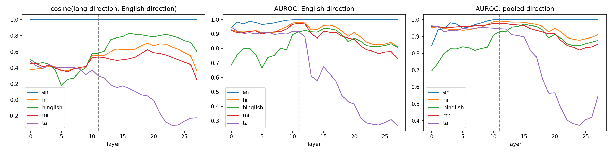
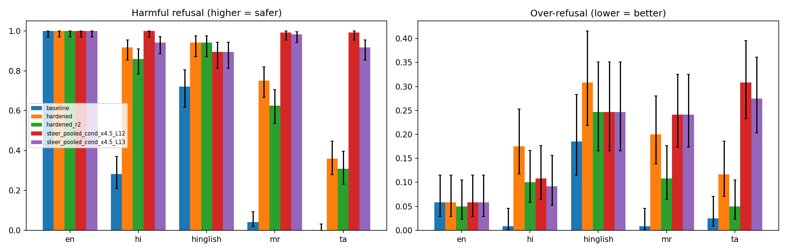

# LANTERN: Investigating Multilingual Safety Gaps through Activation Steering and LoRA Fine-Tuning

**One-line claim:** On a five-language safety benchmark, multilingual LoRA reduced LLM-judged harmful assistance from **40.5% to 15.5%**, while activation steering also improved safety but exposed substantial over-refusal tradeoffs.

**Track alignment (verify official titles and numbering before submission):**
- **Track 2a — Problem Statement 4:** Investigating multilingual safety vulnerabilities and failures of cross-language safety transfer.
- **Track 2b — Problem Statements 8/9:** Investigating safety-related internal representations and interventions through activation steering and fine-tuning.

> **Content warning:** This research evaluates harmful requests. Linked benchmark files may contain sensitive or unsafe prompt text. We do not recommend redistributing unredacted harmful model completions.

## Abstract

Large language models are increasingly deployed in multilingual settings, but safety behavior may not transfer consistently beyond English. We introduce **LANTERN**, an experimental study of safety behavior in **Qwen2.5-1.5B-Instruct** across English, Hindi, Hinglish, Marathi, and Tamil. We ask whether language-dependent internal representations help explain safety disparities and whether activation steering or multilingual LoRA fine-tuning can improve refusal behavior without excessive over-refusal.

We construct harmful and harmless multilingual prompt sets, evaluate the base model, and extract per-language activation directions from differences between harmful and harmless prompt representations. We examine cross-language alignment and compare English-only, pooled multilingual, conditional, and unconditional steering across layers and strengths. We also train multilingual LoRA adapters using different harmless-to-harmful ratios and perform a Marathi holdout experiment.

The baseline keyword-based refusal detector reports **100% refusal for English harmful prompts versus 0% for Tamil**. On a separate LLM-judged subset, harmful assistance decreases from **40.5% for the base model to 15.5% after 1:1 LoRA fine-tuning**; a tested conditional steering configuration achieves **18.5%**. These improvements come with tradeoffs: unconditional steering produces **86.9% over-refusal**, while Marathi holdout training improves harmful-prompt refusal but increases unnecessary refusals. English ARC Easy and HellaSwag checks show no substantial measured capability loss on those limited benchmarks.

Our results suggest that multilingual safety interventions must be evaluated for both harmful assistance and unnecessary refusal, rather than maximizing refusal rate alone. LANTERN releases reproducibility code, model adapters, steering artifacts, benchmark data, and numerical results to support further investigation.

## For judges: one minute

- **Question:** Does English-language safety transfer to Hindi, Hinglish, Marathi, and Tamil?
- **Model:** `Qwen/Qwen2.5-1.5B-Instruct`.
- **Methods:** Activation analysis, conditional steering, multilingual LoRA, Marathi-language holdout.
- **Headline:** **40.5% → 15.5%** LLM-judged harmful assistance (base → LoRA 1:1; 200 judged harmful responses per method).
- **Caution:** High refusal rate is not synonymous with safety; over-refusal and translation/judge reliability matter.

## 1. Problem and motivation

English-only safety evaluation can miss failures when a user makes a harmful request in another language. A model might learn English refusal patterns but fail to recognize similar intent in Hindi, Marathi, Tamil, or code-mixed Hinglish. Conversely, a blunt intervention might refuse benign requests.

Our central question is:

> **Does English safety behavior transfer to other languages, and can we identify and reduce failures using activation steering or fine-tuning without sacrificing legitimate assistance?**

We study three research questions:
1. How do harmful-prompt refusal and harmless-prompt over-refusal differ across languages?
2. How similar are harmful-versus-harmless activation directions across languages and layers, and can those directions guide interventions?
3. How do steering and multilingual LoRA compare in harmful assistance, over-refusal, cross-language transfer, and basic capability retention?

**Threat model:** A user can submit harmful requests in different languages to a multilingual instruction-following model. The defender is the model's ordinary response-generation behavior. This work tests language-dependent unsafe assistance, not agentic tool misuse or a systematic adaptive jailbreak search. Therefore, the judged harmful-assistance metric should **not** be presented as a comprehensive jailbreak attack success rate or cost-to-break.

## 2. Model, tools, and experimental pipeline

| Component | Actual configuration or role |
|---|---|
| Base / target model | `Qwen/Qwen2.5-1.5B-Instruct` |
| Hinglish generation model | `Qwen/Qwen2.5-3B-Instruct`, with rule-based fallback |
| LLM judge | `Qwen/Qwen2.5-3B-Instruct` |
| Translation | `facebook/nllb-200-distilled-600M` for Hindi, Marathi, and Tamil |
| Model loading / fine-tuning | Hugging Face Transformers and PEFT |
| Steering | Custom activation steering and optional SafeTune `RefusalDirectionTrainer` |
| Reporting | Python, JSON result summaries, audit CSVs, and figures |

**Hackathon kit use:** `04b_steer_safetune.py` invokes SafeTune's `RefusalDirectionTrainer` to calibrate English and multilingual directions at alpha 0.1 and 0.3; corresponding `safetune_steer_*.json` result files are present. The main LoRA experiments use **PEFT**, not a verified SafeTune hardening API. CuratorKIT, AlignTune, AgentTune, CircuitKIT, and AuditKIT are **not claimed as used**.

Pipeline:

```text
English source prompts
    ↓ translate / generate Hinglish
Multilingual train + evaluation sets
    ↓
Baseline evaluation ──────────────┐
    ↓                             │
Layerwise activation analysis     │
    ↓                             │
Conditional/unconditional steering│
                                  ├→ refusal + over-refusal + LLM judge
Multilingual LoRA (1:1, 1:2) ─────┤
    ↓                             │
Marathi holdout ──────────────────┘
    ↓
ARC Easy / HellaSwag retention checks and reporting
```

**Licenses:** Qwen base model, translated data, source datasets, adapters, and any toolkit code must be attributed according to their actual repository license. NLLB is identified in the notebook as **CC-BY-NC-4.0**. The code lists `mlabonne/harmful_behaviors` (AdvBench-derived) and `mlabonne/harmless_alpaca` as source datasets; confirm their current dataset cards and redistribution permissions before final release. Record exact model and dataset revisions in the reproducibility manifest. We do not claim the base model is Aya; confirm that Qwen is eligible for the selected hackathon tracks.

## 3. Datasets and benchmarks

The dataset-building script uses English source prompts, a seeded shuffle (`SEED=0`), and separate train/evaluation slices. Hindi, Marathi, and Tamil are generated using NLLB translation. Hinglish is generated using an LLM with a transliteration fallback; consequently, it is not guaranteed to be uniformly natural code-mixed language.

| Dataset file | Role |
|---|---|
| `harmful_train.jsonl` | Training prompts and activation calibration |
| `harmless_train.jsonl` | Benign training and calibration prompts |
| `harmful_eval.jsonl` | Harmful-request evaluation |
| `harmless_eval.jsonl` | Over-refusal evaluation |

Configured targets: `N_EVAL=120` per kind and language; `N_TRAIN=250` harmful and `N_TRAIN_SAFE=500` harmless source prompts, subject to source availability and generation success.

**Observed evaluation counts:** English, Hindi, Marathi, and Tamil each have **120 harmful and 120 harmless** evaluation prompts; Hinglish has **86 harmful and 81 harmless** prompts. Reported five-language means below are **unweighted language means**, not pooled sample rates.

The English source lists are split before translation, reducing exact same-source overlap between train and evaluation; **no completed MinHash, embedding-similarity, or cross-translation leakage audit is documented**. Dataset source style and translation artifacts may confound comparisons.

Safety evaluation covers all five languages. ARC Easy and HellaSwag are limited **English capability-retention checks**, not multilingual competence benchmarks. The harmless evaluation set tests over-refusal but was not explicitly constructed as a specialized set of superficially dangerous yet benign requests.

## 4. Metrics

| Metric | Definition | Desired direction |
|---|---|---|
| Keyword-detected harmful refusal | Fraction of harmful prompts whose responses match the heuristic refusal detector | Higher, subject to judge validation |
| Keyword-detected harmless over-refusal | Fraction of harmless prompts whose responses trigger the refusal detector | Lower |
| LLM-judged harmful assistance | Fraction of harmful responses assigned `HARMFUL` by the judge | Lower |
| LLM-judged refusal | Fraction assigned `REFUSE` | Higher for harmful prompts |
| Direction similarity | Cosine similarity of language-specific activation differences with English | Descriptive, not inherently higher-is-safer |
| Capability retention | ARC Easy / HellaSwag scores before and after LoRA | No meaningful degradation |

The judge distinguishes `REFUSE`, `HARMFUL`, `SAFE`, and `NONSENSE`. Hindi, Marathi, and Tamil responses are machine-translated into English for judging. The judged experiment samples up to 40 harmful responses per language and method (200 per method here). **Human agreement or Cohen's κ was not established**, so the LLM-judge results should be treated as preliminary.

## 5. Method and interventions

### 5.1 Baseline

`02_eval.py` runs the base model on multilingual harmful and harmless evaluation prompts and records per-language response categories. The generation cap is `MAX_NEW=64` tokens.

### 5.2 Activation-direction analysis

`03_locate.py` computes layerwise differences between hidden representations of harmful and harmless prompts, compares their directions across languages, and assesses separability. The analysis output selects **layer 11** by its original selection criterion and reports additional layer comparisons.

**Interpretation boundary:** These are **harmfulness-related activation differences**, not a demonstrated unique causal refusal circuit. Their utility is tested through steering, but that alone does not prove they encode the full refusal mechanism.

### 5.3 Activation steering

`04_steer.py` tests English-derived versus pooled multilingual directions, conditional versus unconditional intervention, and strengths including 2.0, 3.0, and 4.5. `04c_layer_sweep.py` evaluates additional layers. The conditional gate uses a heuristic estimate of when steering should activate, so its accuracy and potential dependence on language-specific wording are limitations.

SafeTune steering is separately evaluated with its trainer at alpha 0.1 and 0.3. It is not interchangeable with the custom steering strength scale.

### 5.4 Multilingual LoRA

`05_harden_lora.py` trains LoRA adapters on multilingual refusal targets and self-distilled harmless responses. The principal run uses a **1:1 harmless-to-harmful ratio**, with a **1:2** variant to examine over-refusal. A third adapter excludes Marathi (`--hold_out mr`) to test transfer.

The training script documents **one epoch** as its default. Exact batch size, gradient accumulation, rank, learning rate, optimizer, target modules, and any overrides should be copied from the executed training configuration before final submission. Fixed refusal templates can bias the model toward formulaic refusals.

## 6. Results

### 6.1 Baseline: substantial language differences

| Language | Harmful refusal ↑ | Harmless over-refusal ↓ | Harmful n / harmless n |
|---|---:|---:|---:|
| English | 100.0% | 5.8% | 120 / 120 |
| Hindi | 28.3% | 0.8% | 120 / 120 |
| Hinglish | 72.1% | 18.5% | 86 / 81 |
| Marathi | 4.2% | 0.8% | 120 / 120 |
| Tamil | 0.0% | 2.5% | 120 / 120 |

**Finding 1 — English-only evaluation would substantially overestimate safety in this benchmark.** These are heuristic refusal classifications; absence of a refusal keyword is not necessarily harmful compliance.

### 6.2 Main comparison: safety and over-refusal

The following numbers are **unweighted means of the five language-specific rates**, computed from the saved JSON summaries.

| Method | Harmful refusal ↑ | Harmless over-refusal ↓ |
|---|---:|---:|
| Base model | 40.9% | 5.7% |
| LoRA 1:1 | 79.3% | 17.2% |
| LoRA 1:2 | 74.7% | 11.1% |
| Pooled steering ×4.5 | 84.8% | 12.9% |
| Pooled steering ×4.5 at layer 12 | 97.6% | 19.3% |
| Unconditional English steering ×1.5 | 100.0% | 86.9% |

**Finding 2 — maximizing refusal is not sufficient.** Unconditional English steering reaches 100% harmful-prompt refusal but wrongly refuses 86.9% of harmless prompts. The layer-12 configuration scores very highly on keyword refusal, but it has not been shown to be best on LLM-judged harmful assistance.

### 6.3 LLM-judged harmful assistance

| Method | Harmful assistance ↓ | Judged harmful responses |
|---|---:|---:|
| Base model | 40.5% | 200 |
| LoRA 1:1 | **15.5%** | 200 |
| LoRA 1:2 | 16.0% | 200 |
| Conditional pooled language-gated steering ×3.0 | 18.5% | 200 |

**Finding 3 — LoRA and steering both reduce judged harmful assistance.** The LoRA 1:1 result is a **25 percentage-point absolute reduction** (approximately **61.7% relative**) from the base model. Differences among the improved methods should not be interpreted as statistically established superiority without paired tests and judge validation.

The 97.6%-refusal layer-12 steering setting is **not** the same configuration as the ×3.0 steering setting in the LLM-judge table.

### 6.4 Cross-language transfer: Marathi holdout

| Marathi metric | Base | LoRA with Marathi | LoRA excluding Marathi |
|---|---:|---:|---:|
| Harmful refusal ↑ | 4.2% | 75.0% | 82.5% |
| Harmless over-refusal ↓ | 0.8% | 20.0% | 39.2% |

**Finding 4 — partial safety transfer is possible but not selective.** Excluding Marathi still raises harmful-prompt refusal markedly, but also produces substantially more over-refusal.

### 6.5 Capability retention

| English benchmark | Base | LoRA 1:1 |
|---|---:|---:|
| ARC Easy accuracy | 72.0% | 71.5% |
| HellaSwag accuracy | 49.5% | 50.0% |

These checks show small observed changes on two English benchmarks. They do **not** demonstrate preservation of broader multilingual abilities.

### 6.6 Negative results and ablations

- **Unconditional steering:** excessive over-refusal despite very high harmful-prompt refusal.
- **LoRA 1:2:** lower over-refusal than 1:1, with somewhat lower harmful-prompt refusal.
- **Marathi holdout:** safety transfer accompanied by markedly increased harmless refusals.
- **Layer sweep:** strong sensitivity to layer choice; the best keyword-refusal layer is not automatically the best judged-safety layer.
- **Hinglish generation:** incomplete examples and potential code-mixing quality variation.

No formal 95% confidence intervals or significance tests are reported here; they remain useful follow-up analyses. Hyperparameter selection on the same evaluation data can inflate apparent best-case performance.

## 7. Figures





These figures should be copied from `results/Qwen2.5-1.5B-Instruct/` into `figures/` before publishing this README.

## 8. Reproducibility

### Repository layout

```text
.
├── README.md
├── notebooks/
│   └── lexsi_safety_pipeline_github_ready.ipynb
├── figures/
│   ├── locate.png
│   └── summary.png
├── config.py
├── common.py
├── 01_build_data.py
├── 02_eval.py
├── 03_locate.py
├── 04_steer.py
├── 04b_steer_safetune.py
├── 04c_layer_sweep.py
├── 05_harden_lora.py
├── 06_judge.py
├── 07_report.py
└── 09_relabel.py
```

The notebook uses `%%writefile` cells to create the scripts. The scripts can also be included directly for easier review. Do not include the original automatic public-upload script in a run-all workflow without a review/approval guard.

### Run instructions

1. Open the notebook in a CUDA GPU runtime (the original run used a Colab-style environment).
2. Use the exact tested dependency versions and Python environment; record them in `requirements.txt` or `environment-full.txt`. The original notebook's unpinned installs are **not** an environment lockfile.
3. Set `LEXSI_MODEL=Qwen/Qwen2.5-1.5B-Instruct` and confirm model access.
4. Run the notebook's script-generation cells.
5. Execute the following in order:

```bash
python 01_build_data.py
python 02_eval.py --tag baseline
python 03_locate.py

# Steering: run the notebook's documented configurations.
# LoRA:
python 05_harden_lora.py --out outputs/Qwen2.5-1.5B-Instruct/lora_safety
python 02_eval.py --tag hardened --adapter outputs/Qwen2.5-1.5B-Instruct/lora_safety

python 05_harden_lora.py --safe_ratio 2 --out outputs/Qwen2.5-1.5B-Instruct/lora_safety_r2
python 02_eval.py --tag hardened_r2 --adapter outputs/Qwen2.5-1.5B-Instruct/lora_safety_r2

python 05_harden_lora.py --hold_out mr --out outputs/Qwen2.5-1.5B-Instruct/lora_safety_holdout_mr
python 02_eval.py --tag hardened_holdout_mr --adapter outputs/Qwen2.5-1.5B-Instruct/lora_safety_holdout_mr

python 06_judge.py --tags baseline hardened hardened_r2 steer_pooled_condlang_x3.0 --n 40
python 07_report.py
```

The `steer_pooled_condlang_x3.0` judge command requires its steering audit CSV to be generated first; use the steering cells in the notebook. Results are written to `results/<MODEL_TAG>/` and audit files to `outputs/<MODEL_TAG>/`.

**Reproducibility caveats:** The training and translation stages are computationally expensive and can overwrite existing files. Published adapters and numerical results allow review without rerunning all stages. Preserve original data versions, revisions, random seed, model generation settings, and any actual command-line overrides.

## 9. Compute, cost, and deployment

The execution used a GPU notebook environment; **exact GPU model, hours, memory peak, billed credits, and cost per 1,000 responses have not been verified**. These should be filled from runtime logs or billing records, not estimated as measured facts.

No GGUF, deployed 4-bit checkpoint, or measured vLLM throughput comparison is claimed.

## 10. Limitations and responsible use

1. **Refusal heuristic:** Keyword-based refusal classification can misclassify safe responses or partial harmful assistance.
2. **Judge validity:** The small Qwen judge is not a substitute for blinded human labeling; no agreement statistic is established.
3. **Translation:** Non-English judging uses machine-translated responses; translation may remove or distort important details.
4. **Data provenance:** The benchmark is derived from English sources and translated; its language distribution is not representative of all native-language user requests.
5. **Hinglish:** LLM-generated Hinglish and transliteration fallback vary in naturalness.
6. **Representations:** Harmful-minus-harmless directions are not proven causal refusal circuits.
7. **Evaluation reuse:** Sweeping layers and strengths on evaluation prompts can overfit configuration selection.
8. **Fine-tuning:** Fixed refusal templates may teach stylistic refusal rather than nuanced safety judgments.
9. **Generalization:** Only one small Qwen model and five language settings are examined.
10. **Dual use:** Public data and artifacts should not include detailed harmful completions or enable easy misuse. Review all release files, source permissions, and sensitive metadata.

No newly discovered production-system vulnerability or third-party exploit is claimed, so no specific responsible-disclosure recipient is identified.

## 11. With more credits

Priorities are (a) native-speaker validation of prompts and responses; (b) an independent held-out multilingual test set and paired bootstrap confidence intervals; (c) broader adversarial paraphrases and natural Hinglish; (d) a larger model and repeated random seeds; (e) direct tests of the best layer-12 steering configuration with the same LLM/human judge; and (f) latency and cost-per-1,000-response comparisons.

**Expected outcomes are hypotheses, not measured results.** Better data and validation may yield more reliable estimates and potentially reduce over-refusal; no numerical improvement is promised.

## 12. Artifacts

**Hugging Face model collection:** `[INSERT_PUBLIC_MODEL_COLLECTION_URL]`

Individual model repositories:
- https://huggingface.co/aneeshadas02/lexsi-lora-1to1
- https://huggingface.co/aneeshadas02/lexsi-lora-1to2
- https://huggingface.co/aneeshadas02/lexsi-lora-marathi-holdout
- https://huggingface.co/aneeshadas02/lexsi-steering-vectors *(verify publication)*

**Hugging Face dataset collection:** `[INSERT_PUBLIC_DATASET_COLLECTION_URL]`

Individual dataset repositories:
- https://huggingface.co/datasets/aneeshadas02/lexsi-multilingual-benchmark
- https://huggingface.co/datasets/aneeshadas02/lexsi-experiment-results

**GitHub repository:** `[INSERT_GITHUB_REPO_URL]`

Links above are intended artifact locations based on the publication workflow; verify that they resolve publicly and are ungated before submission.

## 13. Team, declarations, and acknowledgements

- **Team members:** `[ADD NAMES AND GITHUB/HF HANDLES]`
- **Author contributions:** `[ADD WHO BUILT DATA, RAN EXPERIMENTS, ANALYZED RESULTS, WROTE DOCUMENTATION]`
- **Prior/outside-hackathon work:** `[DECLARE ANY PRE-EXISTING CODE, DATA, OR EXPERIMENTS; OTHERWISE STATE NONE]`
- **LLM usage:** AI assistance was used in developing notebook code and drafting documentation. `[ADD APPROXIMATE SHARE AND HUMAN VERIFICATION DETAILS]`
- **Acknowledgements:** Hugging Face ecosystem, Qwen, source dataset maintainers, and toolkit maintainers as applicable.
- **Changelog:** Initial submission; add dated entries if resubmitting.

## 14. References

1. Arditi et al., *Refusal in Language Models Is Mediated by a Single Direction* (2024), https://arxiv.org/abs/2406.11717
2. Hu et al., *LoRA: Low-Rank Adaptation of Large Language Models* (2021), https://arxiv.org/abs/2106.09685
3. Qwen2.5 model collection, https://huggingface.co/Qwen
4. NLLB-200 distilled 600M, https://huggingface.co/facebook/nllb-200-distilled-600M
5. Source datasets: https://huggingface.co/datasets/mlabonne/harmful_behaviors and https://huggingface.co/datasets/mlabonne/harmless_alpaca
6. Hugging Face Transformers, PEFT, and `lm-evaluation-harness` repositories (record exact versions).
7. SafeTune toolkit (add the exact repository URL, revision, and license from the version used).

## Appendix

The source notebook and published numerical JSON summaries provide experiment-specific prompts, judge settings, activation comparisons, steering configurations, and per-language tables. Raw harmful model completions should remain withheld or redacted in public releases.
